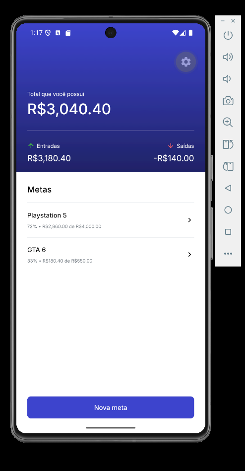
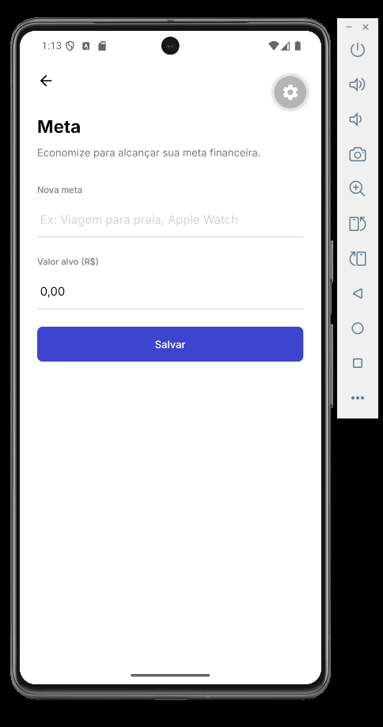
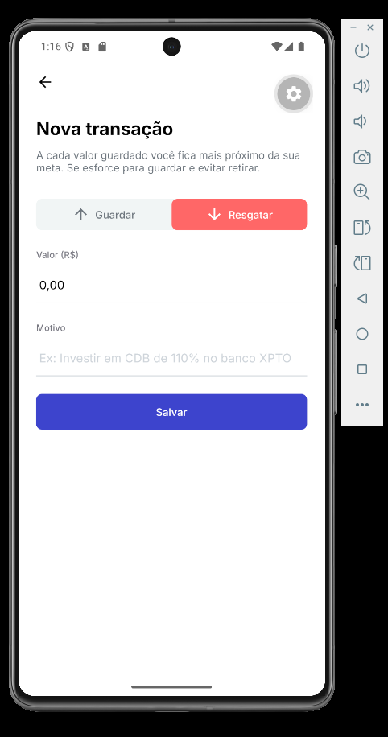
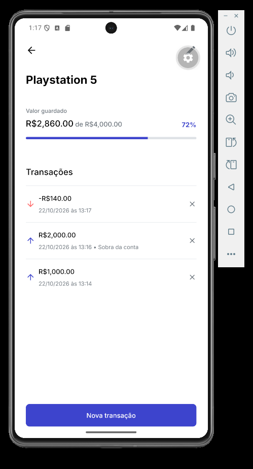

# 🎯 Target — Controle de Metas Financeiras

<p align="center">
  
</p>

<p align="center">
  Organize suas finanças, acompanhe seu progresso e conquiste seus objetivos.
</p>

<p align="center">
  
  
  
  
</p>

---

## 📱 Sobre o projeto

O **Target** é um aplicativo mobile de organização financeira desenvolvido para ajudar no controle do dinheiro e no acompanhamento de metas pessoais.

Com ele, é possível registrar valores guardados e resgatados, visualizar o saldo disponível e acompanhar o progresso de cada objetivo financeiro.

## ✨ Funcionalidades

- 💰 **Resumo financeiro:** visualização do saldo total, entradas e saídas.
- 🎯 **Criação de metas:** definição de objetivos e valores desejados.
- 📈 **Acompanhamento de progresso:** visualização do valor acumulado e da porcentagem alcançada.
- 🔄 **Registro de transações:** operações de guardar e resgatar valores.
- 📋 **Histórico por meta:** consulta das transações relacionadas a cada objetivo.
- 💾 **Persistência local:** armazenamento de dados com SQLite.

## 🖼️ Screenshots

### Tela inicial

<p align="center">
  
</p>

### Criação de meta

<p align="center">
  
</p>

### Nova transação

<p align="center">
  
</p>

### Progresso da meta

<p align="center">
  
</p>

## 🛠️ Tecnologias utilizadas

- [React Native](https://reactnative.dev/) — desenvolvimento mobile.
- [Expo](https://expo.dev/) — ferramentas e ambiente de desenvolvimento.
- [Expo Router](https://docs.expo.dev/router/introduction/) — navegação entre telas.
- [TypeScript](https://www.typescriptlang.org/) — tipagem estática.
- [Expo SQLite](https://docs.expo.dev/versions/latest/sdk/sqlite/) — banco de dados local.
- [Day.js](https://day.js.org/) — manipulação de datas.

## ⚙️ Como executar o projeto

### Pré-requisitos

- Node.js e npm instalados.
- Android Studio com emulador Android ou um dispositivo compatível.
- Git instalado.

### Instalação

1. Clone o repositório:

   ```bash
   git clone https://github.com/lipefelizardo1/Target.git
   ```

2. Entre na pasta:

   ```bash
   cd Target
   ```

3. Instale as dependências:

   ```bash
   npm install
   ```

4. Inicie o projeto:

   ```bash
   npm start
   ```

Para executar diretamente no Android, com o ambiente nativo configurado:

```bash
npm run android
```

## 👨‍💻 Autor

**Lipe Felizardo**

- GitHub: [@lipefelizardo1](https://github.com/lipefelizardo1)

---

<p align="center">
  Desenvolvido com 💙 como projeto de estudos em desenvolvimento mobile.
</p>
